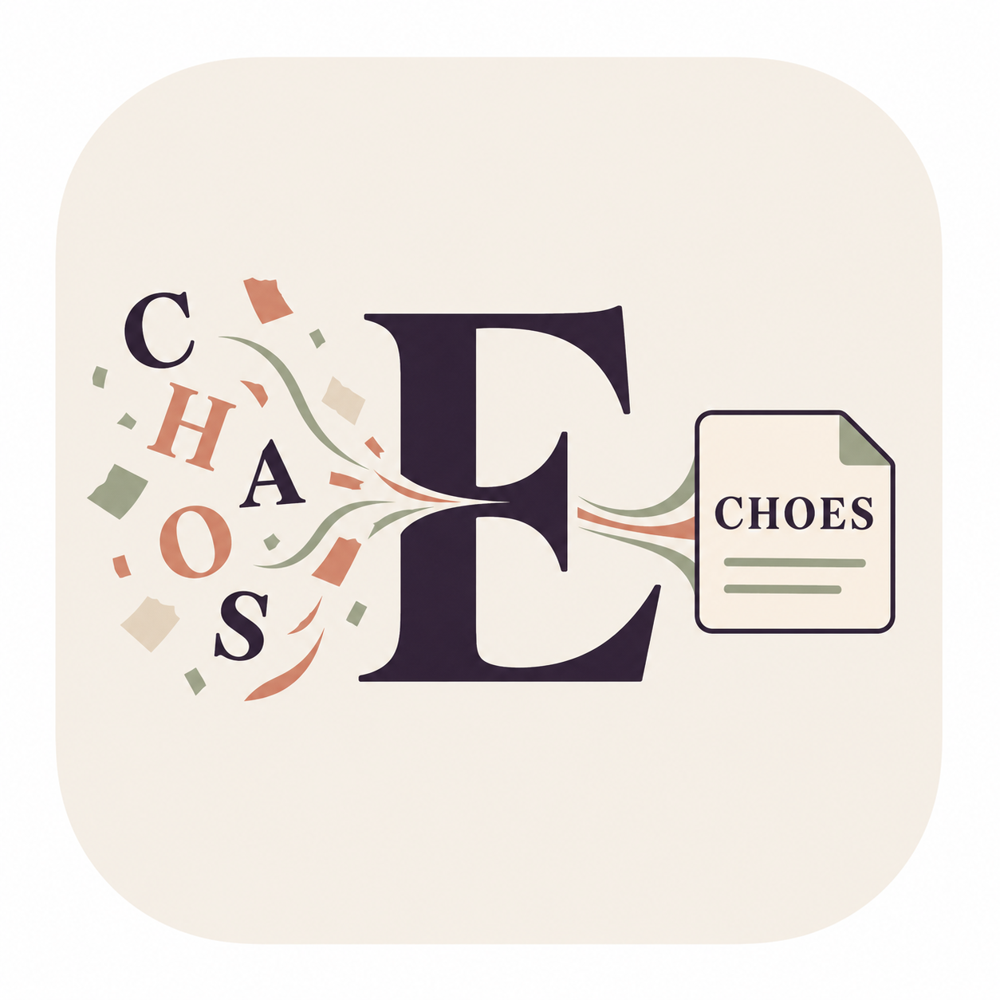

# Echoes 回响

[English](README.md)

> **把散落在 AI 对话里的自己，收集回来。**

Echoes 是一个以本地 Markdown 和 Obsidian 为中心的个人 AI 对话整理工作流。它帮助你把散落在 ChatGPT、DeepSeek、Codex 等 AI 对话中的想法、规划、待办、问题、决定和资料线索收集起来，保留来源，再由 AI 协助整理与回顾。

AI 对话像一团 `CHAOS`：有灵感，也有重复、未验证的建议和暂时搁置的问题。Echoes 把它们汇集成可追溯、可检索、可持续整理的个人知识回响。



## 开始使用

1. 将仓库克隆或下载到你的 Obsidian Vault 中，并把项目文件夹命名为 `Echoes`。
2. 安装上文提到的三个 Codex Skills。
3. 在 `Echoes/Inbox/Raw/` 中放入网页聊天导出，或在 Codex 中调用捕获 Skill。
4. 按“整理来源 → 提炼内容 → 审阅入库”的流程使用其他 Skills。

`Inbox/Raw/`、`Inbox/Review/` 和 `Inbox/Processed/` 中的个人内容已加入 `.gitignore`。分享或提交前仍应检查 Git 变更，确保没有私人对话进入仓库。

## 设计原则

- **本地优先**：以普通 Markdown 文件作为长期数据，Obsidian Vault 是知识库。
- **来源可追溯**：整理后的笔记链接回原始对话；原文与提炼内容分开保存。
- **区分观点归属**：标明内容来自用户、AI 建议、双方确认或尚不确定。
- **先审阅再入库**：AI 生成候选条目和整理建议，用户确认后才写入正式分类。
- **渐进整理**：先捕获，再索引和提炼，不要求保存时立刻完成归档。

## 工作流

1. **网页聊天**：安装 [AI Chat Exporter](https://github.com/Covai-Labs/ace)，打开 ChatGPT、DeepSeek 等对话，使用扩展导出 Markdown。将文件保存或移动到 Obsidian 库的 `Echoes/Inbox/Raw/`。如果用扩展的 Obsidian 直发功能创建在其他位置，再把导出的原文移入 `Raw/`。
2. **Codex 会话**：在 Codex 桌面端或 VS Code 中调用 `ai-notes-inbox-capture`，把当前会话保存到 `Inbox/Raw/`。该 Skill 只能收集当前可用的会话上下文，不能读取未提供给它的历史会话。
3. **整理来源**：调用 `ai-notes-inbox-organize`。它会盘点原始聊天，提出主题索引和处理状态报告；确认后才创建或更新索引，不改动原文。
4. **提炼内容**：指定一条或多条来源，调用 `ai-notes-inbox-distill`。它会提取想法、规划、待办、问题、决定和资料线索，标注内容归属，并生成 `Inbox/Review/` 草稿。
5. **审阅入库**：在 Codex 中审阅草稿，指出要保存或修改的条目。得到你的明确确认后，Skill 才把批准内容写入相应分类，并链接回原始对话。

## Codex Skills

仓库提供三个 Codex Skills，可安装到用户级目录 `~/.codex/skills/`。Codex 桌面端和 VS Code 中的 Codex 在使用同一 Codex 配置时可复用这些 Skills。

| Skill | 用途 |
| --- | --- |
| `ai-notes-inbox-capture` | 保存当前 Codex 会话，或将已导入的 AI 聊天 Markdown 作为原始来源收集。 |
| `ai-notes-inbox-organize` | 按主题整理原始收件箱、生成来源索引并汇报处理状态，不修改原文。 |
| `ai-notes-inbox-distill` | 从选定来源提炼候选知识，检查关联和重复，并在确认后入库。 |

### 安装

将 `Skills/` 下三个 Skill 文件夹复制到 Codex 用户 Skills 目录：

```bash
mkdir -p ~/.codex/skills
cp -R Skills/ai-notes-inbox-* ~/.codex/skills/
```

重启或刷新 Codex 后，可在 Skill 选择器中调用，也可以用自然语言描述需求，例如：

- `用 ai-notes-inbox-capture 保存这段 Codex 对话。`
- `用 ai-notes-inbox-organize 梳理 Echoes Inbox 的原始对话。`
- `用 ai-notes-inbox-distill 整理 Raw 里的这条聊天，先生成待确认草稿。`

> Skill 只能处理当前会话上下文和你提供/可访问的本地文件。它不会声称能读取当前上下文之外的 Codex 历史记录。

## 浏览器聊天导入

网页聊天可使用 [AI Chat Exporter](https://github.com/Covai-Labs/ace) 导出为 Markdown，再保存到 `Inbox/Raw/`。该扩展是独立的第三方项目，不包含在本仓库中；请按其官方说明单独安装和配置。

当前仓库的 Skills 负责后续的本地收集与整理，不会自动监听网页或后台同步聊天。Codex 桌面端或 VS Code 当前会话通过 `ai-notes-inbox-capture` 保存。

## 致谢

感谢 [AI Chat Exporter](https://github.com/Covai-Labs/ace) 提供跨 AI 网页对话的本地导出能力。Echoes 将其作为浏览器聊天采集的推荐入口；该项目由 Covai-Labs 独立维护，遵循其自己的许可证和发布节奏。

## 目录结构

```text
Echoes/
├── Inbox/
│   ├── Raw/          # 原始聊天导出（本地个人内容，不提交）
│   ├── Review/       # 等待确认的提炼草稿
│   └── Processed/    # 整理报告与已处理来源记录
├── Ideas/            # 已确认的想法
├── Plans/            # 已确认的规划
├── Tasks/            # 已确认的待办
├── Questions/        # 待解决的问题
├── Decisions/        # 已确认的决定
├── References/       # 资料线索
├── Skills/           # 可安装的 Codex Skills
└── Templates/        # Markdown 模板
```

## 内容归属

每条提炼内容会标记为以下一种：

- `user`：用户明确表达。
- `assistant`：AI 提出的建议，不代表用户认同。
- `shared`：对话中明确形成共识。
- `uncertain`：无法判断归属或是否采纳。

不得把 AI 建议自动改写成用户的观点、决定或待办；不得凭空补充截止日期、承诺或来源。

## 适用范围与当前状态

Echoes 当前提供 Obsidian 目录结构、Markdown 模板和 Codex Skills。浏览器扩展安装、历史数据批量导入、自动同步、自动语义去重和跨设备服务不属于当前版本能力。

平台网页结构和 Codex 的本地会话可访问范围可能变化；请在使用时核对导出结果和来源链接。原始对话通常包含个人信息，公开分享前请先检查并移除敏感内容。

## 许可证

Echoes 使用 [MIT License](LICENSE)。AI Chat Exporter 是独立项目，不包含在本仓库中，并遵循其自己的许可证。

